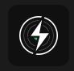

<div align="center">



# Decksplice

**From playlist to decks.**

Open-source DJ playlist preparation CLI for Spotify, lossless music files, rekordbox and USB drives.

[](https://github.com/AmpedWasTaken/Decksplice/actions/workflows/ci.yml)
[](LICENSE)
[](https://nodejs.org/)
[](#installation)

[Quick start](#quick-start) · [Features](#features) · [Commands](#commands) · [FAQ](#faq) · [Roadmap](#roadmap)

</div>

---

Decksplice turns a Spotify playlist or CSV tracklist into an organized DJ music library. Match existing local files, find artist-authorized FLAC downloads, verify audio integrity, convert to AIFF/WAV/FLAC, estimate BPM and hot cues, and generate rekordbox XML or portable M3U8 playlists.

Built for DJs who want less manual track hunting and more time behind the decks. No account or paid subscription is required for local processing.

> **Early development:** Decksplice is a working CLI foundation, not yet a production-certified CDJ export engine. Spotify and Jamendo integrations require credentials; experimental cue estimates need manual review.

## Features

| Capability | Status |
| --- | --- |
| Spotify playlist metadata / CSV import | Implemented |
| Local music library scanning and exact track matching | Implemented |
| Artist-authorized Jamendo FLAC discovery and download | Implemented; live validation pending |
| Bandcamp, SoundCloud and Beatport discovery links | Implemented |
| FLAC, AIFF and WAV conversion with FFmpeg | Implemented |
| Decode integrity check and lossy codec rejection | Implemented |
| Concurrent preparation, manifest and resume | Implemented |
| BPM / first-beat and structural cue estimation | Experimental |
| rekordbox XML and M3U8 playlist export | Implemented; rekordbox import validation pending |
| USB audio and M3U8 copying | Implemented |
| Camelot key detection, spectral analysis, full TUI | Planned |

## Quick start

```sh
git clone https://github.com/AmpedWasTaken/Decksplice.git
cd Decksplice
npm install
npm run build
npm link
decksplice doctor
```

Prepare a DJ playlist with audio you already own:

```sh
decksplice prepare examples/playlist.csv --library ./music --out ./prepared --format aiff --analyze
```

Example terminal output (illustrative):

```text
Indexed 256 local files; 4 tracks
1/4 READY Artist - Extended Mix
2/4 READY Artist - Warehouse Tool
3/4 MISSING Artist - Unavailable Edit
4/4 LOSSY Artist - Original Mix
2/4 ready · ./prepared
```

Decksplice never silently substitutes a radio edit for an extended mix, and does not convert a known lossy codec into a pretend lossless source.

## Installation

Requires Node.js 22+ and FFmpeg (including ffprobe) on PATH.

| OS | FFmpeg |
| --- | --- |
| Windows | `winget install Gyan.FFmpeg` |
| macOS | `brew install ffmpeg` |
| Ubuntu/Debian | `sudo apt install ffmpeg` |

Restart your shell if necessary, then follow the quick start. Use `npm start -- --help` if you prefer not to install a global command. No npm registry release is currently required.

## Spotify playlist to DJ USB

1. Import a playlist you can access using a Spotify Web API access token, or export a CSV from your playlist manager.
2. Match tracks to your local lossless files, or enable Jamendo for artist-authorized downloads.
3. Prepare the output and review the manifest for ambiguous, missing or lossy tracks.
4. Import the generated rekordbox XML into compatible rekordbox software and verify BPM, beatgrids and hot cues.
5. Use rekordbox's own export mode to create a CDJ-compatible device database, or use Decksplice to copy audio and M3U8 files.

### Import Spotify playlists

Set `SPOTIFY_ACCESS_TOKEN` in your environment with the necessary playlist access and run:

```sh
decksplice import "https://open.spotify.com/playlist/YOUR_PLAYLIST_ID" --out playlist.csv
```

Spotify API access depends on your application, account and playlist permissions. CSV import is always available. This command retrieves metadata only, not Spotify audio.

### CSV format

```csv
title,artist,duration seconds,isrc
"Example Track (Extended Mix)","Example Artist",240,
```

Title and artist are required; duration and ISRC are optional. Quoted CSV fields and common export column names are supported.

### Find free, authorized lossless music

Set `JAMENDO_CLIENT_ID` from your own Jamendo developer account:

```sh
decksplice prepare playlist.csv --jamendo --out ./prepared --format flac
decksplice search playlist.csv
```

Jamendo downloads require explicit artist download permission. Search also generates discovery links to Bandcamp, SoundCloud and Beatport, where you can obtain authorized copies. Availability is not guaranteed; check license terms for your intended use.

## Commands

| Command | Purpose |
| --- | --- |
| `decksplice` | Interactive setup |
| `decksplice doctor` | Check FFmpeg and Node |
| `decksplice import URL --out playlist.csv` | Spotify metadata import |
| `decksplice prepare CSV --library PATH --out PATH` | Match, verify, convert and export |
| `decksplice search CSV` | Discover authorized sources and stores |
| `decksplice verify FILE` | Decode and inspect audio codec |
| `decksplice analyze FILE` | Experimental BPM and cue estimates |
| `decksplice status --out PATH` | Inspect preparation manifest |
| `decksplice usb --out PATH --drive PATH` | Copy audio and playlist to a new USB folder |

Preparation options: `--format aiff|wav|flac`, `--jamendo`, `--analyze`, `--resume`, `--jobs 1..8`, `--min-bpm`, `--max-bpm`.

Exit codes: 0 = success, 1 = error, 2 = partial preparation or lossy verification.

## Output

```text
prepared/
├── 001 - Artist - Track.aiff
├── 002 - Artist - Other Track.aiff
├── manifest.json
├── playlist.m3u8
└── rekordbox.xml
```

AIFF and WAV output use 16-bit, 44.1 kHz stereo PCM for compatibility; FLAC retains source sample rate and channels where supported. This can reduce precision of higher-resolution masters, so keep originals. Files are not overwritten; use a clean output folder or resume the same playlist. Prepared files are SHA-256 checked before resume and USB export, independently of unreliable AIFF/WAV tags. Older manifests without checksums must be rebuilt in a new output folder. After an unexpected shutdown, check for a stale lock and partial output before resuming.

## FAQ

### Can I convert a Spotify playlist to FLAC for free?

Decksplice imports Spotify track metadata and matches legally obtained lossless audio. It can download artist-authorized tracks where available, but cannot turn protected Spotify streaming or offline files into standalone audio. Some tracks require purchase.

### Does Decksplice work with rekordbox and Pioneer DJ CDJs?

It generates rekordbox XML for import and M3U8 playlists. Actual CDJ/AlphaTheta device database export must be performed in rekordbox. Verify compatibility with your player and rekordbox version before a gig.

### Which format should DJs use: FLAC, WAV or AIFF?

AIFF is a practical choice for compatibility and metadata. WAV also offers broad playback support. FLAC is smaller without lossy compression but is not supported on every older player. Decksplice supports all three.

### Does verification detect fake FLAC?

It verifies codec and decoding integrity, and rejects known lossy inputs. It cannot prove a file was never transcoded from MP3; spectral analysis is planned.

### Can Decksplice generate hot cues automatically?

Experimental first beat, drop, breakdown and outro estimates are available with `--analyze`. They are heuristic, not guaranteed to be musically correct. Key detection and full eight-slot cue generation are planned.

## Roadmap

- [x] Local lossless library matching and export
- [x] Spotify metadata and authorized provider integration
- [x] Concurrent preparation and resumable manifest
- [x] Experimental BPM and structural cue detection
- [ ] Cross-platform integration and live service validation
- [ ] Interactive terminal dashboard and persistent library database
- [ ] Camelot key, phrase-aware hot cues and spectral quality checks
- [ ] Verified rekordbox import and additional DJ software export
- [ ] Signed installers and package registry release

## Development

```sh
npm install
npm test
```

Contributions are welcome. Open an issue for a bug, provider suggestion, DJ hardware compatibility report or feature idea. Please include your OS, Node version and relevant command output without secrets.

## License

MIT. Decksplice is independent and is not affiliated with Spotify, AlphaTheta, Pioneer DJ, rekordbox, Jamendo or Beatport. Only download or process music you are authorized to use.

<div align="center">

**Made for DJs. Built for the terminal.**

[Report a bug](https://github.com/AmpedWasTaken/Decksplice/issues) · [Star on GitHub](https://github.com/AmpedWasTaken/Decksplice)

</div>
